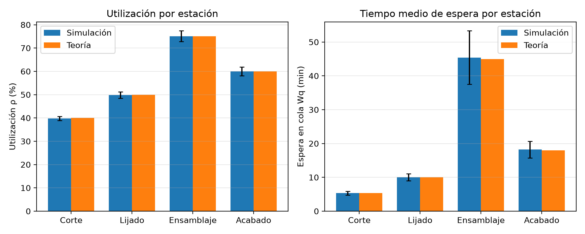
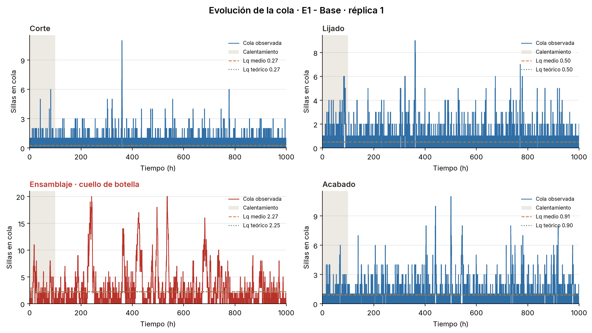
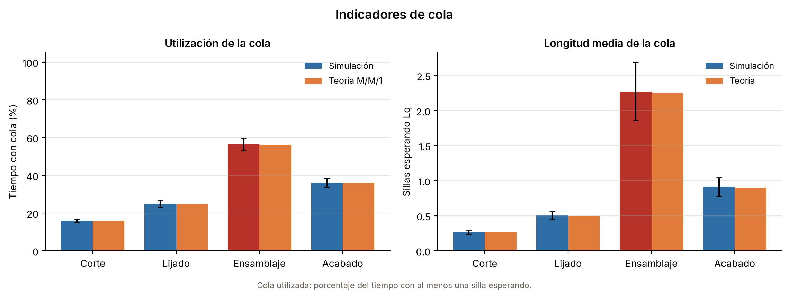
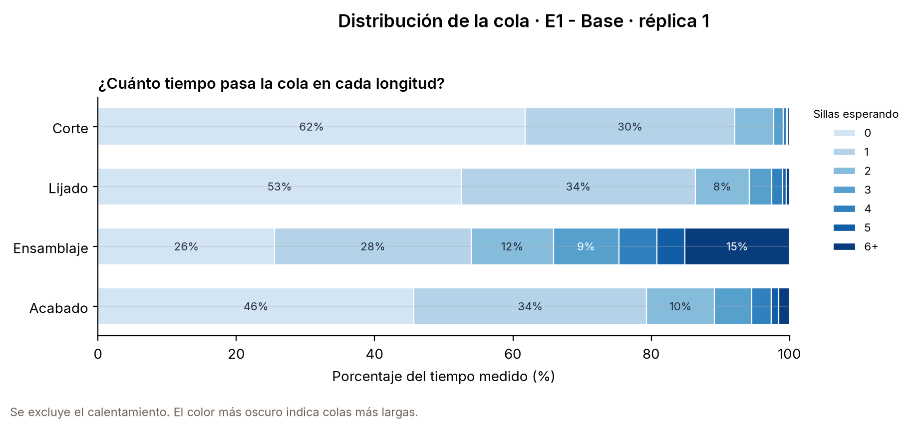
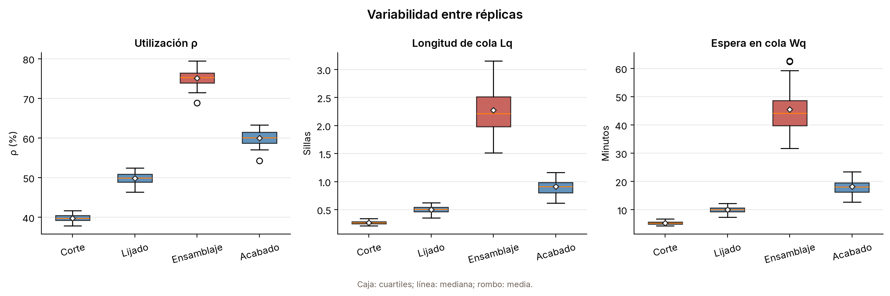
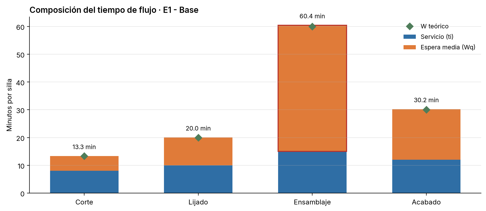
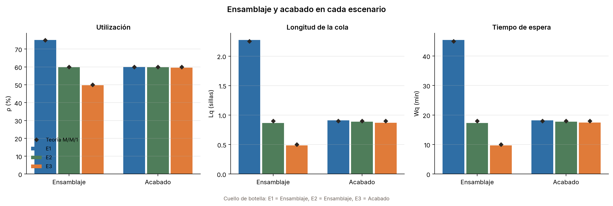

# Simulación de una línea de producción de muebles con SimPy

| Campo | Detalle |
| --- | --- |
| Asignatura | Simulación |
| Ciclo | 5.º ciclo - FEIRNNR, Carrera de Computación |
| Práctica | Trabajo grupal de simulación |
| Docente | José O. Guamán Q. |
| Integrantes | Victor Roa, Francis Valdiviezo, Cael Soto, Jimmy Ontaneda, Alejandro Padilla |

## 1. Descripción del proyecto

El programa simula una línea de fabricación de sillas con cuatro estaciones en serie:
**corte → lijado → ensamblaje → acabado**. Las sillas llegan al azar, esperan en una cola
FIFO y son atendidas por un operario en cada estación.

**Propósito:** comparar los indicadores de la simulación con los valores teóricos del
modelo M/M/1 y encontrar la estación que limita la producción.

**Supuestos del modelo:**

- Llegadas de Poisson con tasa `λ` sillas por hora.
- Tiempos de servicio exponenciales con media `ti` minutos.
- Cola FIFO sin límite en cada estación.
- Un operario por estación (`c = 1`) en todos los escenarios.
- No hay fallas, turnos, transporte ni retrabajo.

**Teoría utilizada: M/M/1.** Cada estación tiene un solo operario (`c = 1`) en todos los
escenarios, así que se compara con M/M/1 y no con M/M/c ni con Erlang C. M/M/1 es el caso
particular de M/M/c con `c = 1`. El simulador conserva la capacidad de trabajar con más
operarios (`recursos > 1`) y la animación los dibuja, pero la teoría del informe solo
evalúa una persona por estación: si se configura `recursos > 1`, la simulación corre
igual y la comparación teórica muestra `—` (ver sección 8).

**Parámetros de la línea base:**

| Estación | Operarios `ci` | Tiempo medio `ti` (min/silla) |
| --- | :---: | :---: |
| Corte | 1 | 8 |
| Lijado | 1 | 10 |
| Ensamblaje | 1 | 15 |
| Acabado | 1 | 12 |

Tasa de llegadas: `λ = 3` sillas/h. Cada réplica simula 1 000 h y descarta las primeras
100 h de calentamiento.

| Medida | Significado | Fórmula M/M/1 |
| --- | --- | --- |
| `ρ` | Ocupación de la estación | `λ / μ` |
| `Lq` | Sillas esperando en cola | `ρ² / (1 − ρ)` |
| `Wq` | Espera media en cola | `Lq / λ` |
| `W` | Tiempo en la estación | `Wq + 1/μ` |
| `L` | Sillas en el sistema (cola + servicio) | `λ · W` |
| `P(N > 1)` | Probabilidad de que haya al menos una silla esperando | `ρ²` |

## 2. Tecnologías utilizadas

- Python 3.12 o superior
- SimPy (eventos discretos y recursos)
- NumPy (números aleatorios)
- pandas (resultados en CSV)
- Matplotlib (gráficos y animación)
- pytest (pruebas)
- Organización en modelo, vista y controlador (MVC)

## 3. Instalación

Las dependencias están fijadas en `requirements.txt`.

**Ubuntu / Debian:**

```bash
sudo apt update
sudo apt install python3 python3-venv python3-pip
cd simulacion-linea-muebles
python3 -m venv .venv
source .venv/bin/activate
python -m pip install -r 03-simulacion/requirements.txt
```

**macOS:**

```bash
cd simulacion-linea-muebles
python3 -m venv .venv
source .venv/bin/activate
python -m pip install -r 03-simulacion/requirements.txt
```

**Windows PowerShell:**

```powershell
cd simulacion-linea-muebles
py -3.12 -m venv .venv
.\.venv\Scripts\Activate.ps1
python -m pip install -r 03-simulacion\requirements.txt
```

Si PowerShell bloquea la activación, ejecutar una vez:

```powershell
Set-ExecutionPolicy -Scope Process Bypass
```

En Windows CMD la activación es `.venv\Scripts\activate.bat`.

Para ver la animación en Linux hace falta Tk (`sudo apt install python3-tk`). En WSL o en
un servidor sin pantalla, usar `--guardar` como se explica en la sección 4.

## 4. Uso

### 4.1 Activar el entorno virtual

Todos los comandos de esta sección se ejecutan con el Python del entorno virtual.
Desde la raíz del repositorio:

**Linux / macOS:**

```bash
source .venv/bin/activate
```

**Windows PowerShell:**

```powershell
.\.venv\Scripts\Activate.ps1
```

**Windows CMD:**

```bat
.venv\Scripts\activate.bat
```

Comprobar que quedó activo:

```bash
python --version
```

Debe mostrar Python 3.12 o superior. Si `python` no existe, usá `python3` o directamente
el Python del entorno: `.venv/bin/python` en Linux/macOS y `.venv\Scripts\python.exe` en Windows.

### 4.2 Ejecutar la simulación base

```bash
cd 03-simulacion
python main.py
```

Si no activaste el entorno, desde `03-simulacion/`:

```bash
../.venv/bin/python main.py
```

En Windows:

```powershell
..\.venv\Scripts\python.exe main.py
```

Esto ejecuta `escenarios/base.json` y escribe:

| Archivo | Contenido |
| --- | --- |
| `resultados-base.csv` | Una fila por réplica y estación. |
| `resumen-base.csv` | Promedios, desviación, teoría M/M/1, error porcentual y Ley de Little. |
| `linea-base.csv` | Producción, flujo total y Ley de Little de la línea. |
| `graficos/base.png` | Utilización y espera: simulación frente a teoría. |
| `graficos/cola-base.png` | Evolución de la cola en el tiempo (réplica 1). |
| `graficos/utilizacion-cola-base.png` | Tiempo con cola y longitud media de la cola. |
| `graficos/distribucion-cola-base.png` | Distribución de la longitud de la cola. |
| `graficos/replicas-base.png` | Variabilidad de ρ, Lq y Wq entre réplicas. |
| `graficos/flujo-base.png` | Composición del tiempo de flujo por estación. |
| `graficos/escenarios.png` | Comparación de escenarios (solo si se simulan varios). |

Los nombres de salida salen del archivo JSON: `base.json` produce `resultados-base.csv`,
`resumen-base.csv`, `linea-base.csv` y `graficos/*-base.png`; `e2.json` produce `*-e2.*`,
y así. La única excepción es `escenarios.png`: **solo se crea si se pasan dos o más
escenarios en la misma corrida** (ver 4.3).

**Cómo se calculan las cifras:**

- La ventana medida es `duracion_h − calentamiento_h`: 900 h en los tres escenarios.
- `ρ`, `Lq`, la utilización de la cola y el percentil 90 se ponderan por tiempo.
- `Wq` promedia solo las sillas que entraron a la estación después del calentamiento.
- Cada réplica usa una semilla distinta derivada de `semilla`; con la misma semilla los
  resultados se repiten.
- Los CSV guardan promedio y desviación estándar de las 30 réplicas.

**Columnas de `resumen-*.csv`:** identificación (`estacion`, `recursos`, `tiempo_min`,
`capacidad_h`), simulación (`utilizacion_media/desv`, `lq_media/desv`,
`wq_min_media/desv`, `cola_utilizacion_media/desv`, `cola_max_media`, `cola_p90_media`),
teoría (`utilizacion_teorica`, `lq_teorico`, `wq_min_teorico`,
`cola_utilizacion_teorica`), errores (`error_utilizacion_pct`, `error_lq_pct`,
`error_wq_pct`) y Ley de Little (`lq_little`, `error_little_pct`).

**Columnas de `linea-*.csv`:** `sillas_terminadas`, `sillas_desv`, `throughput_h`,
`flujo_min`, `flujo_desv`, `escenario`, `cuello`, `throughput_teorico_h`,
`error_throughput_pct`, `flujo_teorico_min`, `error_flujo_pct`, `lq_total`,
`lq_little_total`, `error_little_total_pct`.

**Qué muestra cada gráfico:**

- **`base.png`**: utilización de cada estación y espera media `Wq`, con la teoría M/M/1 al lado.
- **`cola-base.png`**: cómo cambia la longitud de la cola durante una réplica. La franja gris es el
  calentamiento y las líneas punteadas marcan `Lq` simulado y teórico.
- **`utilizacion-cola-base.png`**: porcentaje del tiempo con al menos una silla esperando
  (utilización de la cola) y longitud media `Lq`.
- **`distribucion-cola-base.png`**: porcentaje del tiempo que la cola pasa con 0, 1, 2, … sillas.
- **`replicas-base.png`**: cajas de `ρ`, `Lq` y `Wq` para ver cuánto varían las 30 réplicas.
- **`flujo-base.png`**: cuánto del tiempo total de una silla es servicio y cuánto es espera.
- **`escenarios.png`**: utilización, `Lq` y `Wq` de ensamblaje y acabado en E1, E2 y E3,
  con el valor teórico marcado con un rombo.

**Indicadores de cola:**

| Métrica | Significado |
| --- | --- |
| `cola_utilizacion` | Fracción del tiempo con al menos una silla esperando (`N > 1`). |
| `cola_p90` | Percentil 90 de la longitud de la cola, ponderado por tiempo. |
| `cola_max` | Longitud máxima observada durante la ventana medida. |
| `cola_utilizacion_teorica` | `P(N > 1) = ρ²` del modelo M/M/1. |
| `lq_little` | `λ_efectiva · Wq / 60` para comprobar la Ley de Little. |
| `error_little_pct` | Error porcentual entre `Lq` medido y el de la Ley de Little. |

En la terminal se muestra el resumen por estación, la producción por hora, el tiempo de
flujo, la Ley de Little y el cuello de botella.

### 4.3 Ejecutar otros escenarios

```bash
python main.py --config escenarios/e2.json
python main.py --config escenarios/base.json escenarios/e2.json escenarios/e3.json
python main.py --config escenarios/e2.json --salida ../04-experimentos
```

| Archivo | Escenario | Diferencia con E1 |
| --- | --- | --- |
| `escenarios/base.json` | E1 (base) | — |
| `escenarios/e2.json` | E2 | Ensamblaje en 12 min |
| `escenarios/e3.json` | E3 | Ensamblaje en 10 min |

Los tres usan un solo operario por estación (`c = 1`), `λ = 3` sillas/h y los mismos
corte, lijado y acabado de E1. Los resultados llevan el nombre del archivo:
`resumen-e2.csv`, `linea-e2.csv`, `graficos/e2.png`, etc.

`--salida` cambia la carpeta de resultados y gráficos. Los escenarios se validan todos
antes de simular; si uno tiene un error, no se escribe nada.

**Cómo se genera `escenarios.png`:**

```bash
python main.py --config escenarios/base.json escenarios/e2.json escenarios/e3.json
```

Se escribe en `graficos/escenarios.png` **solo cuando hay dos o más escenarios en esa
corrida**; si se ejecutan por separado, cada uno genera sus PNG pero no la comparación.
El gráfico tiene tres paneles (ρ, `Lq` y `Wq`) y compara **ensamblaje y acabado**, con
barras para la simulación y un rombo negro para la teoría M/M/1.

En E2 ensamblaje y acabado empatan en 60 % de utilización, así que el rótulo del cuello
de botella muestra el que quedó levemente arriba en la simulación (ensamblaje). En E3 el
cuello pasa a acabado porque ensamblaje baja a 50 %.

### 4.4 Ejecutar las pruebas

```bash
python -m pytest
```

Desde la raíz del repositorio:

```bash
python -m pytest 03-simulacion
```

### 4.5 Ver la animación del taller

```bash
python animacion.py
python animacion.py --config escenarios/e2.json --horas 24
python animacion.py --guardar graficos/base.gif
```

La animación usa una sola réplica y sirve para explicar la dinámica; los números del
informe salen de `main.py`. Dibuja un operario por cada `recursos` de la estación y la
ocupación del cartel es la teórica (`λ/(c·μ)`), no la simulada. Las opciones principales son:

- `--horas`: horas simuladas a mostrar (por defecto 8).
- `--paso`: minutos simulados por cuadro (por defecto 5).
- `--semilla`: semilla de la réplica.
- `--guardar`: guarda un GIF en vez de abrir una ventana.

Para una prueba rápida sin abrir ventana:

```bash
python animacion.py --horas 2 --paso 10 --guardar graficos/prueba.gif
```

En Linux, para abrir la ventana hace falta Tk (`sudo apt install python3-tk`). En WSL,
SSH o servidores sin pantalla, usá siempre `--guardar`.

### 4.6 Cambiar los valores desde una ventana (panel)

```bash
python panel.py
python panel.py --config escenarios/e2.json   # arranca con los valores de E2
```

Se abre una ventana con casillas para `λ`, los operarios `c` y el tiempo `t` de cada
estación, las réplicas, la duración, el calentamiento y la semilla. Se acepta coma o punto
decimal (`4,5` o `4.5`).

| Botón | Qué hace |
| --- | --- |
| **Simular** | Corre las réplicas con los valores escritos y muestra la utilización simulada frente a la teórica, una tabla con `ρ`, `Lq`, `Wq` y el error, el cuello de botella (en rojo), la producción y el tiempo de flujo. |
| **Animar** | Abre la animación del taller con esos mismos valores (las horas salen de "Horas a animar"). |
| **Guardar escenario** | Escribe `escenarios/personalizado.json` para repetir el caso con `python main.py --config escenarios/personalizado.json`. |
| **Restaurar** | Vuelve a los valores con los que se abrió el panel. |

Si un valor no sirve (texto, negativo, cero operarios, calentamiento mayor que la duración),
el panel muestra el error en rojo y no simula. Si una estación recibe más sillas de las que
puede atender (`λ ≥ c·μ`), la simulación corre igual, pero el panel avisa que esa cola crece
sin límite y no muestra valor teórico. Si se pone `c > 1`, la simulación y la animación
funcionan, pero la comparación teórica sale `—` porque la teoría del informe es M/M/1.

Con 30 réplicas de 1 000 h, cada simulación tarda unos 15 s. Para probar rápido, bajá las
réplicas o la duración.

### 4.7 Solución de problemas

| Problema | Causa probable | Solución |
| --- | --- | --- |
| `python: command not found` | El entorno virtual no está activado | `source .venv/bin/activate` o usá `../.venv/bin/python` |
| `No module named 'simpy'` o `'matplotlib'` | Estás usando el Python del sistema | Activá el venv o usá el Python de `.venv` |
| `No module named 'vista'` o `No such file: animacion.py` | Estás en la carpeta equivocada | `cd 03-simulacion` |
| `TclError: no display name and no $DISPLAY` | No hay entorno gráfico | Usá `--guardar graficos/base.gif` |
| La ventana se abre y la terminal queda ocupada | La animación sigue en ejecución | Cerrá la ventana para terminar |
| El GIF tarda mucho | Son muchos cuadros | Probá `--horas 2 --paso 10` |
| `No such file: escenarios/e2.json` | Ruta relativa desde otra carpeta | Ejecutá desde `03-simulacion` o pasá la ruta completa |

Si el error persiste, copiá el mensaje completo y el comando que ejecutaste.

## 5. Configuración: dónde cambiar los valores

**Ningún valor de la línea está escrito dentro del código Python.** Todos salen de un
escenario JSON. Hay dos formas de cambiarlos:

| Forma | Dónde | Cuándo usarla |
| --- | --- | --- |
| Panel de parámetros | `python panel.py` (sección 4.6) | Para cambiar valores en vivo frente al docente. |
| Archivo de escenario | `escenarios/base.json` (o una copia) | Para dejar un escenario guardado y repetirlo con `main.py`. |

En el archivo, cada valor de la línea base está en este lugar:

```json
{
  "nombre": "E1 - Base",
  "tasa_llegadas_h": 3,            ← λ: sillas que llegan por hora
  "estaciones": [
    {"nombre": "Corte",      "recursos": 1, "tiempo_min": 8},   ← c1 y t1
    {"nombre": "Lijado",     "recursos": 1, "tiempo_min": 10},  ← c2 y t2
    {"nombre": "Ensamblaje", "recursos": 1, "tiempo_min": 15},  ← c3 y t3
    {"nombre": "Acabado",    "recursos": 1, "tiempo_min": 12}   ← c4 y t4
  ],
  "replicas": 30,                  ← réplicas independientes
  "duracion_h": 1000,              ← horas por réplica
  "calentamiento_h": 100,          ← horas iniciales que no se miden
  "semilla": 2026                  ← misma semilla, mismos resultados
}
```

Las flechas son solo explicación: JSON no admite comentarios, así que el archivo real no las
lleva. [`escenarios/README.md`](escenarios/README.md) repite esta guía junto a los archivos.

Los escenarios están en `escenarios/`. No hay parámetros de la línea escritos dentro del
código: todo lo que cambia entre corridas está en el JSON.

**Parámetros del escenario:**

| Campo JSON | Símbolo | Significado | Unidad | Valor en E1 |
| --- | :---: | --- | :---: | :---: |
| `nombre` | — | Nombre que aparece en la terminal y en los resultados. | — | `E1 - Base` |
| `tasa_llegadas_h` | `λ` | Tasa de llegadas de Poisson. | sillas/h | 3 |
| `replicas` | `r` | Réplicas independientes por escenario. | — | 30 |
| `duracion_h` | `T` | Duración de cada réplica, incluido el calentamiento. | h | 1 000 |
| `calentamiento_h` | `Tc` | Horas iniciales que se descartan. | h | 100 |
| `semilla` | `s0` | Semilla base; cada réplica deriva la suya. | — | 2026 |
| `estaciones` | — | Lista ordenada del recorrido de la silla. | — | 4 |

**Parámetros de cada estación:**

| Campo JSON | Símbolo | Significado | Unidad | E1 (corte/lijado/ensamblaje/acabado) |
| --- | :---: | --- | :---: | :---: |
| `nombre` | — | Nombre de la estación. | — | Corte, Lijado, Ensamblaje, Acabado |
| `recursos` | `c` | Operarios en paralelo. | personas | 1 en todas |
| `tiempo_min` | `ti` | Tiempo medio de servicio exponencial. | min/silla | 8, 10, 15, 12 |

**Indicadores teóricos (M/M/1) que se calculan a partir de esos parámetros:**

| Símbolo | Fórmula | Significado |
| --- | :---: | --- |
| `μ` | `60 / ti` | Tasa de servicio de una persona (sillas/h). |
| `Ci` | `c · μ` | Capacidad de la estación (sillas/h). |
| `ρ` | `λ / μ` | Utilización (con `c = 1`; en general `λ / (c·μ)`). |
| `Lq` | `ρ² / (1 − ρ)` | Sillas esperando en promedio. |
| `Wq` | `Lq / λ` | Espera media en cola (se muestra en minutos). |
| `W` | `Wq + 1/μ` | Tiempo total en la estación. |
| `L` | `λ · W` | Sillas en el sistema (cola + servicio). |
| `P(N > 1)` | `ρ²` | Fracción del tiempo con al menos una silla esperando. |
| Error % | `abs(sim − teórico) / teórico × 100` | Separación entre simulación y teoría. |

**Para probar otros resultados no se toca Python:**

- Otro tiempo de proceso: cambiar `tiempo_min` de la estación.
- Otra demanda: cambiar `tasa_llegadas_h`.
- Más o menos réplicas, otra duración o calentamiento: cambiar `replicas`,
  `duracion_h` o `calentamiento_h`.
- Otra semilla: cambiar `semilla` (los resultados dejan de ser comparables con los del
  informe).
- Más operarios: poner `recursos > 1`. La simulación y la animación lo soportan; la
  comparación teórica sale `—` porque la teoría es M/M/1.

Para crear un escenario, copiar `escenarios/base.json`, cambiar los valores y pasar el
archivo con `--config`. Antes de simular se rechazan campos faltantes o desconocidos,
tipos incorrectos, nombres repetidos, valores negativos, `NaN`, `Infinity`, tasas no
positivas, estaciones vacías y `calentamiento_h >= duracion_h`. Si un escenario falla, no
se escribe ningún archivo.

Si una estación queda inestable (`ρ ≥ 1`), el programa **simula igual** (la cola crece),
pero la teoría se muestra como `—` y el flujo como "sin teoría M/M/1": no se ajusta nada
para que coincida.

## 6. Estructura del proyecto

```text
03-simulacion/
├── main.py                  # entrada: simula uno o varios escenarios
├── animacion.py             # entrada de la animación
├── panel.py                 # entrada: ventana para cambiar valores y simular
├── requirements.txt
├── modelo/
│   ├── configuracion.py     # lee y valida los JSON
│   ├── simulacion.py        # Estacion y SimulacionLinea (SimPy)
│   └── teoria.py            # fórmulas M/M/1
├── vista/
│   ├── tablas.py            # salida de la terminal
│   ├── graficas.py          # gráficos PNG
│   ├── animacion.py         # dibujo del taller
│   └── panel.py             # ventana de parámetros
├── controlador/
│   └── controlador.py       # une modelo y vista
├── escenarios/
│   ├── base.json
│   ├── e2.json
│   └── e3.json
├── tests/
├── fuentes/                 # fuente Inter y su licencia
├── graficos/               # PNG por escenario y escenarios.png
├── resultados-base.csv
├── resumen-base.csv
├── linea-base.csv
└── resultados-base.md       # texto de la sección 7.1 (ya integrado en el informe)
```

Los resultados de los tres escenarios (E1, E2 y E3) están en
[`../04-experimentos/`](../04-experimentos/README.md).

- **modelo:** calcula. No imprime ni dibuja.
- **vista:** muestra tablas, gráficos y animación. No simula.
- **controlador:** lee escenarios, llama al modelo y pasa los resultados a la vista.

## 7. Información adicional

**Funcionalidades:**

- Simulación de la línea con estaciones, colas FIFO y un operario por estación en todos los
  escenarios (el motor admite varios operarios, pero la teoría del informe es M/M/1).
- Comparación automática con la teoría M/M/1 y verificación de la Ley de Little.
- Detección del cuello de botella por utilización.
- Verificación de la Ley de Little y del tiempo total de flujo por escenario.
- Indicadores de cola: utilización, percentil 90 y máximo.
- Resultados en CSV y gráficos PNG.
- Gráficos de evolución, distribución, variabilidad, flujo y comparación de escenarios.
- Validación de escenarios antes de ejecutar.
- Panel para cambiar los parámetros, simular y animar sin editar archivos.
- Animación del taller para una réplica.

**Resultados de la línea base:**

| Estación | ρ simulado | ρ teórico | Cola ocupada | Wq simulado (min) | Wq teórico (min) |
| --- | :---: | :---: | :---: | :---: | :---: |
| Corte | 39,8 % | 40,0 % | 15,9 % | 5,3 | 5,3 |
| Lijado | 49,8 % | 50,0 % | 24,9 % | 10,0 | 10,0 |
| Ensamblaje | 75,1 % | 75,0 % | 56,4 % | 45,4 | 45,0 |
| Acabado | 60,0 % | 60,0 % | 36,1 % | 18,2 | 18,0 |

El cuello de botella es **Ensamblaje**. Su cola permanece ocupada el 56,4 % del tiempo y es la que
más se acerca a su valor teórico (56,3 %). El detalle y el texto de apoyo están en
[`resultados-base.md`](resultados-base.md).













**Escenarios:**

| Archivo | Escenario | Cambio respecto de E1 | Flujo teórico |
| --- | --- | --- | :---: |
| `escenarios/base.json` | E1 | Línea base. | 123,3 min |
| `escenarios/e2.json` | E2 | Ensamblaje en 12 min. | 93,3 min |
| `escenarios/e3.json` | E3 | Ensamblaje en 10 min. | 83,3 min |

En E1 el cuello de botella es ensamblaje (75 %). En E2, ensamblaje y acabado empatan
al 60 %; en E3 el cuello pasa a acabado (60 %) porque ensamblaje baja al 50 %. La
producción se mantiene en 3 sillas/h en los tres escenarios porque la línea entrega
todo lo que llega.



**Resumen numérico por escenario:**

| Escenario | ρ ensamblaje | Lq ensamblaje | Wq ensamblaje (min) | Error máx. ρ/Lq/Wq |
| --- | :---: | :---: | :---: | :---: |
| E1 | 75,1 % | 2,27 | 45,4 | 1,26 % |
| E2 | 59,8 % | 0,87 | 17,3 | 4,07 % |
| E3 | 49,7 % | 0,48 | 9,7 | 3,22 % |

El error máximo de E2 (4,07 % en `Wq` de ensamblaje) está dentro del 5 %; el resto de
las estaciones queda por debajo del 3,3 %. Los valores por estación están en
`resumen-e2.csv` y `resumen-e3.csv`, y la Ley de Little en `linea-e2.csv` y `linea-e3.csv`.

## 8. Notas y decisiones del modelo

**Por qué M/M/1**

- Todos los escenarios usan **un operario por estación** (`c = 1`), así que la teoría
  correcta es M/M/1.
- M/M/1 es el caso particular de M/M/c con `c = 1`; no se usa Erlang C.
- La cola ocupada teórica es `P(N > 1) = ρ²`. Antes se calculaba con Erlang C × ρ, pero
  para `c = 1` ambas expresiones son la misma.
- Si se configura `recursos > 1`, el programa **simula** y la **animación** dibuja varios
  operarios, pero la teoría M/M/1 no aplica: la comparación muestra `—` y el flujo
  "sin teoría M/M/1". No hay escenario del informe con más de un operario.

**Nombres y archivos**

- E1 vive en `escenarios/base.json` (nombre interno `E1 - Base`) para conservar
  `resumen-base.csv` y la serie de resultados ya presentada. Las salidas usan el nombre
  del archivo: `base`, `e2`, `e3`.
- `graficos/escenarios.png` **solo** se genera cuando se pasan dos o más escenarios en la
  misma corrida. Compara ensamblaje y acabado y marca la teoría con un rombo. Si la línea
  no tiene esas estaciones, usa las del primer escenario.
- `linea-*.csv` es nuevo: resume producción, flujo y Ley de Little de toda la línea.

**Qué mide cada indicador**

- `ρ`, `Lq`, `cola_utilizacion` y `cola_p90` se ponderan por tiempo sobre la ventana
  medida (900 h), no sobre sillas individuales.
- `Wq` promedia solo las sillas que entraron a la estación después del calentamiento; el
  flujo, solo las que terminaron después del calentamiento.
- `cola_max` es el máximo observado en la ventana; `cola_p90` es el percentil 90
  ponderado por tiempo.
- `cola-*.png` y `distribucion-cola-*.png` muestran **solo la réplica 1** (la traza); el
  resto de los indicadores usa las 30 réplicas.
- `replicas-*.png` no es un promedio: muestra la dispersión de `ρ`, `Lq` y `Wq` entre
  réplicas.
- Ley de Little: `lq_little = throughput × Wq / 60` por estación, y `lq_little_total`
  usa la suma de las estaciones en `linea-*.csv`.

**Cuello de botella y empates**

- Se elige la estación con mayor `utilizacion_media`; si hay empate, gana la primera en el
  orden de la línea.
- En E2 ensamblaje y acabado empatan en 60 % teórico: la simulación deja ensamblaje
  apenas arriba (59,839 % vs. 59,836 %, una diferencia de 0,003 puntos). En E3 el cuello
  es acabado.

**Los resultados no se fuerzan**

- Ningún parámetro se ajusta para acercar la simulación a la teoría. Los errores se
  reportan tal como salen; el mayor actual es 4,07 %.
- Si una estación queda inestable (`ρ ≥ 1`), la simulación sigue (la cola crece), pero la
  teoría sale `—` y el flujo "sin teoría M/M/1".

**Animación y reproducibilidad**

- La animación usa **una sola réplica** y sirve para explicar la dinámica; las cifras del
  informe salen de `main.py`.
- La simulación es reproducible: misma semilla → mismos resultados. E1 se comparó contra
  una copia del resumen anterior y quedó idéntico.
- Las pruebas (82) incluyen teoría M/M/1, los tres escenarios, Ley de Little, regresión y
  gráficos: `python -m pytest`.
