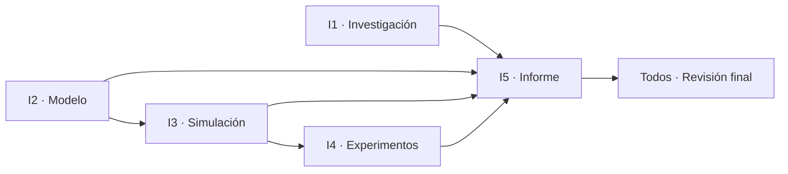

# Simulación de una línea de producción de muebles

Proyecto grupal: simulación de eventos discretos de una línea de fabricación de sillas (corte → lijado → ensamblaje → acabado), con modelo matemático, programa en Python, experimentos y un informe académico en formato IEEE.

El modelo teórico es **M/M/1** (un operario por estación) y se ejecutan tres escenarios: **E1** (base), **E2** (ensamblaje en 12 min) y **E3** (ensamblaje en 10 min).

> **Regla de oro:** cada integrante trabaja **solo en su carpeta** y sube sus cambios con un Pull Request. Nadie edita la carpeta de otro sin avisar. La única excepción es actualizar la tabla de estados de este README.

---

## Inicio rápido

Requiere Python 3.12 o superior. Las instrucciones completas, la explicación de cada gráfica
y la solución de problemas están en [`03-simulacion/README.md`](03-simulacion/README.md).

**Linux / macOS:**

```bash
python3 -m venv .venv
source .venv/bin/activate
python -m pip install -r 03-simulacion/requirements.txt
cd 03-simulacion
python main.py
python -m pytest
```

**Windows PowerShell:**

```powershell
py -3.12 -m venv .venv
.\.venv\Scripts\Activate.ps1
python -m pip install -r 03-simulacion\requirements.txt
cd 03-simulacion
python main.py
python -m pytest
```

Si `python` no existe, usá `python3` o el Python del entorno virtual:
`.venv/bin/python` en Linux/macOS y `.venv\Scripts\python.exe` en Windows.

Para generar la animación como GIF, sin abrir ventana:

```bash
cd 03-simulacion
python animacion.py --guardar graficos/base.gif
```

> **Nota:** si el comando `python` falla, casi siempre es porque el entorno virtual no está
> activado. Los comandos de esta guía suponen que estás dentro de `03-simulacion/`.

---

## Tablero de tareas

Marcá `[x]` cuando tu tarea esté terminada **y** subida (PR aceptado). Cada integrante tiene además su propio [Issue](../../issues) con el mismo checklist.

| Fase | Integrante | Rol | Carpeta | Depende de | Issue | Estado |
|:---:|---|---|---|---|:---:|:---:|
| 1 | Integrante 1 | Investigación y marco teórico | [`01-investigacion/`](01-investigacion/) | — | [#1](../../issues/1) | ⬜ |
| 1 | Integrante 2 | Modelo matemático | [`02-modelo/`](02-modelo/) | — | [#2](../../issues/2) | ⬜ |
| 1–2 | Integrante 3 | Programación y simulación | [`03-simulacion/`](03-simulacion/) | Parámetros de I2 (Tablas V–VII del informe) | [#3](../../issues/3) | ✅ |
| 3 | Integrante 4 | Experimentos y análisis | [`04-experimentos/`](04-experimentos/) | Código de I3 | [#4](../../issues/4) | ⬜ |
| 4 | Integrante 5 | Integración e informe final | [`05-informe/`](05-informe/) | Todos | [#5](../../issues/5) | ⬜ |
| 5 | Todos | Revisión cruzada final | — | Todos | [#6](../../issues/6) | ⬜ |

Estados: ⬜ pendiente · 🟨 en progreso · ✅ terminado

---

## Orden de trabajo



1. **Primero:** los integrantes 1 y 2 investigan y definen el sistema, mientras el 3 prepara la estructura del programa.
2. **Segundo:** el integrante 3 implementa el modelo con los parámetros definidos por el integrante 2.
3. **Tercero:** el integrante 4 ejecuta los experimentos con el programa y documenta los resultados.
4. **Cuarto:** el integrante 5 consolida el informe; los integrantes 1 y 4 aportan las fuentes y la evidencia necesarias para la discusión.
5. **Finalmente:** los cinco revisan que los resultados del documento coincidan con los del código y que las conclusiones respondan a los objetivos.

---

## Tareas por integrante

### Integrante 1 — Investigación y marco teórico
*Responsable de las fuentes científicas* · Carpeta: `01-investigacion/`

- [ ] Buscar y analizar al menos 5 artículos científicos sobre simulación de eventos discretos, líneas de producción y fabricación de muebles.
- [ ] Redactar la introducción y los antecedentes.
- [ ] Explicar los conceptos teóricos relevantes.
- [ ] Preparar las citas y referencias en formato IEEE.

**Entregable:** introducción con antecedentes científicos y referencias verificables.
**Archivos esperados:** `introduccion.md`, `marco-teorico.md`, `referencias.md` (o `.bib`), PDFs/enlaces de los artículos en `articulos/`.

### Integrante 2 — Modelo matemático
*Responsable del diseño del sistema* · Carpeta: `02-modelo/`

- [ ] Describir el proceso: corte, lijado, ensamblaje y acabado.
- [ ] Identificar entidades, recursos, eventos y variables de estado.
- [ ] Definir los tiempos de procesamiento y los supuestos del modelo.
- [ ] Formular las ecuaciones de capacidad, utilización y cuello de botella.

**Entregable:** diagrama del proceso, tabla de parámetros y modelo matemático.
**Archivos esperados:** `diagrama-proceso.png`, `parametros.md` (tabla que usará I3), `modelo-matematico.md`.

> ⚠️ Subí `parametros.md` **lo antes posible**: el integrante 3 lo necesita para programar.

### Integrante 3 — Programación y simulación
*Responsable de implementar el modelo* · Carpeta: `03-simulacion/`

- [x] Desarrollar el programa en Python 3 con SimPy (NumPy y pandas para los datos), según la sección 6.4.6 del informe.
- [x] Representar las estaciones y los recursos disponibles: corte → lijado → ensamblaje → acabado, cada una con su cola FIFO sin límite y `ci` recursos que atienden una silla a la vez.
- [x] Simular las llegadas, los tiempos de procesamiento y las colas: llegadas de Poisson con λ = 3 sillas/h y tiempos de servicio exponenciales con media `ti`.
- [x] Registrar las sillas terminadas, las esperas y la utilización de los recursos: por réplica, `ρi`, `Lq`, `Wq` por estación y el tiempo total de flujo.

**Parámetros de la línea base (Tabla V del informe):**

| Estación | ci | ti (min/silla) |
|---|:---:|:---:|
| Corte | 1 | 8 |
| Lijado | 1 | 10 |
| Ensamblaje | 1 | 15 |
| Acabado | 1 | 12 |

**Configuración de la corrida:** línea vacía al inicio, 30 réplicas independientes con semillas distintas, 1 000 h por réplica y 100 h de calentamiento descartadas.

**Para el integrante 4:** `ci` y `ti` deben poder cambiarse sin tocar el código, porque los escenarios E2 (`t3 = 12` min) y E3 (`t3 = 10` min) de la Tabla VII se corren con el mismo programa.

```bash
cd 03-simulacion
python main.py --config escenarios/base.json escenarios/e2.json escenarios/e3.json \
  --salida ../04-experimentos
```

**Control:** el promedio de la simulación base debe acercarse a la Tabla VI del informe (por ejemplo, ensamblaje con ρ ≈ 75 % y Wq ≈ 45 min).

**Entregable:** código ejecutable, instrucciones de ejecución y resultados de la simulación base.
**Archivos esperados:** `main.py`, `modelo/`, `vista/`, `controlador/`, `escenarios/`, `tests/`, `requirements.txt`, `README.md` con cómo ejecutar, `resultados-base.csv`.

### Integrante 4 — Experimentos y análisis
*Responsable de evaluar las alternativas* · Carpeta: `04-experimentos/`

- [ ] Ejecutar y documentar los tres escenarios experimentales.
- [ ] Comparar la línea base con las dos mejoras de tiempo en ensamblaje.
- [ ] Calcular las diferencias y errores porcentuales frente a los valores teóricos aplicables.
- [ ] Crear tablas y gráficos comparativos.
- [ ] Identificar el cuello de botella y la alternativa más conveniente.

**Entregable:** resultados experimentales, gráficas y análisis comparativo.
**Archivos esperados:** `escenarios.md`, `resultados-*.csv`, `resumen-*.csv`, `graficos/*.png`, `analisis.md`.

### Integrante 5 — Integración e informe final
*Responsable de consolidar el documento* · Carpeta: `05-informe/`

- [ ] Redactar la metodología general con los aportes de los integrantes 2 y 3.
- [ ] Elaborar la discusión relacionando los resultados con los artículos científicos.
- [ ] Redactar conclusiones y recomendaciones a partir de los resultados reales.
- [ ] Preparar el resumen, las palabras clave y la declaratoria de uso de IA.
- [ ] Unificar el documento y verificar el formato IEEE.

**Entregable:** informe académico completo y revisado, listo para entregar.
**Archivos esperados:** `informe.docx` / `informe.pdf` (versión final) y borradores en `borradores/`.

### Todos — Revisión final

- [ ] Los resultados del informe coinciden con los que produce el código.
- [ ] Las conclusiones responden a los objetivos.
- [ ] Todas las referencias citadas existen y están en formato IEEE.
- [ ] Cada integrante aprobó el documento final.

---

## Cómo subir tu parte

### Opción A — Desde la web de GitHub (sin instalar nada)

1. Entrá a tu carpeta (por ejemplo `02-modelo/`).
2. **Add file → Upload files** y arrastrá tus archivos.
3. Abajo elegí **"Create a new branch for this commit and start a pull request"**.
4. Nombrá la rama `integrante-N/descripcion` (ej. `integrante-2/parametros`) y creá el PR.
5. En la descripción del PR escribí `Closes #N` con el número de tu Issue si terminaste todo.

### Opción B — Con Git

```bash
git clone https://github.com/AlejandroTatum/simulacion-linea-muebles.git
cd simulacion-linea-muebles
git checkout -b integrante-2/parametros
# ... agregá tus archivos en TU carpeta ...
git add 02-modelo/
git commit -m "Integrante 2: tabla de parámetros"
git push -u origin integrante-2/parametros
```

Después abrí el Pull Request en GitHub.

### Reglas

- Trabajá **solo dentro de tu carpeta**; la única excepción es la tabla de estados de este README.
- Nombres de archivo sin espacios ni tildes: `modelo-matematico.md`, no `Modelo Matemático.md`.
- Un PR por entrega; no subas todo de golpe al final.
- Si dependés del trabajo de otro, comentá en su Issue en lugar de esperar en silencio.
- Cuando termines, actualizá el estado en la tabla del tablero (⬜ → ✅).

---

## Estructura del repositorio

```
simulacion-linea-muebles/
├── 01-investigacion/   # Integrante 1 — artículos, introducción, referencias IEEE
├── 02-modelo/          # Integrante 2 — diagrama, parámetros, ecuaciones
├── 03-simulacion/      # Integrante 3 — código Python y resultados base
│   ├── modelo/         # configuración, simulación y teoría
│   ├── vista/          # tablas, gráficos y animación
│   ├── controlador/    # une modelo y vista
│   ├── escenarios/     # archivos JSON de parámetros
│   └── tests/          # pruebas automáticas
├── 04-experimentos/    # Integrante 4 — escenarios, tablas y gráficos
│   └── graficos/
└── 05-informe/         # Integrante 5 — informe final consolidado
```
