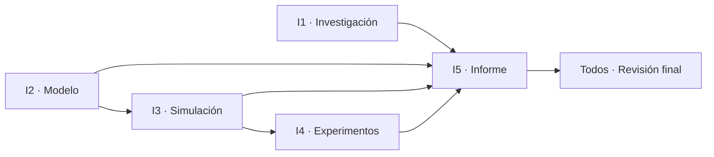

# Simulación de una línea de producción de muebles

Proyecto grupal: simulación de eventos discretos de una línea de fabricación de sillas (corte → lijado → ensamblaje → acabado), con modelo matemático, programa en Python, experimentos y un informe académico en formato IEEE.

> **Regla de oro:** cada integrante trabaja **solo en su carpeta** y sube sus cambios con un Pull Request. Nadie edita la carpeta de otro sin avisar.

---

## Tablero de tareas

Marcá `[x]` cuando tu tarea esté terminada **y** subida (PR aceptado). Cada integrante tiene además su propio [Issue](../../issues) con el mismo checklist.

| Fase | Integrante | Rol | Carpeta | Depende de | Estado |
|:---:|---|---|---|---|:---:|
| 1 | Integrante 1 | Investigación y marco teórico | [`01-investigacion/`](01-investigacion/) | — | ⬜ |
| 1 | Integrante 2 | Modelo matemático | [`02-modelo/`](02-modelo/) | — | ⬜ |
| 1–2 | Integrante 3 | Programación y simulación | [`03-simulacion/`](03-simulacion/) | Parámetros de I2 | ⬜ |
| 3 | Integrante 4 | Experimentos y análisis | [`04-experimentos/`](04-experimentos/) | Código de I3 | ⬜ |
| 4 | Integrante 5 | Integración e informe final | [`05-informe/`](05-informe/) | Todos | ⬜ |
| 5 | Todos | Revisión cruzada final | — | Todos | ⬜ |

Estados: ⬜ pendiente · 🟨 en progreso · ✅ terminado

---

## Orden de trabajo



1. **Primero:** los integrantes 1 y 2 investigan y definen el sistema, mientras el 3 prepara la estructura del programa.
2. **Segundo:** el integrante 3 implementa el modelo con los parámetros definidos por el integrante 2.
3. **Tercero:** el integrante 4 ejecuta los experimentos con el programa y documenta los resultados.
4. **Cuarto:** el integrante 5 consolida el informe; los integrantes 1 y 4 aportan las fuentes y la evidencia necesarias para la discusión.
5. **Finalmente:** los cinco revisan que los resultados del documento coincidan con los del código y que las conclusiones respondan a los objetivos.

---

## Tareas por integrante

### Integrante 1 — Investigación y marco teórico
*Responsable de las fuentes científicas* · Carpeta: `01-investigacion/`

- [ ] Buscar y analizar al menos 5 artículos científicos sobre simulación de eventos discretos, líneas de producción y fabricación de muebles.
- [ ] Redactar la introducción y los antecedentes.
- [ ] Explicar los conceptos teóricos relevantes.
- [ ] Preparar las citas y referencias en formato IEEE.

**Entregable:** introducción con antecedentes científicos y referencias verificables.
**Archivos esperados:** `introduccion.md`, `marco-teorico.md`, `referencias.md` (o `.bib`), PDFs/enlaces de los artículos en `articulos/`.

### Integrante 2 — Modelo matemático
*Responsable del diseño del sistema* · Carpeta: `02-modelo/`

- [ ] Describir el proceso: corte, lijado, ensamblaje y acabado.
- [ ] Identificar entidades, recursos, eventos y variables de estado.
- [ ] Definir los tiempos de procesamiento y los supuestos del modelo.
- [ ] Formular las ecuaciones de capacidad, utilización y cuello de botella.

**Entregable:** diagrama del proceso, tabla de parámetros y modelo matemático.
**Archivos esperados:** `diagrama-proceso.png`, `parametros.md` (tabla que usará I3), `modelo-matematico.md`.

> ⚠️ Subí `parametros.md` **lo antes posible**: el integrante 3 lo necesita para programar.

### Integrante 3 — Programación y simulación
*Responsable de implementar el modelo* · Carpeta: `03-simulacion/`

- [ ] Desarrollar el programa en Python.
- [ ] Representar las estaciones y los recursos disponibles.
- [ ] Simular las llegadas, los tiempos de procesamiento y las colas.
- [ ] Registrar las sillas terminadas, las esperas y la utilización de los recursos.

**Entregable:** código ejecutable, instrucciones de ejecución y resultados de la simulación base.
**Archivos esperados:** `src/` (código), `requirements.txt`, `README.md` con cómo ejecutar, `resultados-base.csv`.

### Integrante 4 — Experimentos y análisis
*Responsable de evaluar las alternativas* · Carpeta: `04-experimentos/`

- [ ] Ejecutar y documentar los tres escenarios experimentales.
- [ ] Comparar la línea base con el aumento de recursos y la mejora de tiempos.
- [ ] Calcular las diferencias y errores porcentuales frente a los valores teóricos aplicables.
- [ ] Crear tablas y gráficos comparativos.
- [ ] Identificar el cuello de botella y la alternativa más conveniente.

**Entregable:** resultados experimentales, gráficas y análisis comparativo.
**Archivos esperados:** `escenarios.md`, `resultados/*.csv`, `graficos/*.png`, `analisis.md`.

### Integrante 5 — Integración e informe final
*Responsable de consolidar el documento* · Carpeta: `05-informe/`

- [ ] Redactar la metodología general con los aportes de los integrantes 2 y 3.
- [ ] Elaborar la discusión relacionando los resultados con los artículos científicos.
- [ ] Redactar conclusiones y recomendaciones a partir de los resultados reales.
- [ ] Preparar el resumen, las palabras clave y la declaratoria de uso de IA.
- [ ] Unificar el documento y verificar el formato IEEE.

**Entregable:** informe académico completo y revisado, listo para entregar.
**Archivos esperados:** `informe.docx` / `informe.pdf` (versión final) y borradores en `borradores/`.

### Todos — Revisión final

- [ ] Los resultados del informe coinciden con los que produce el código.
- [ ] Las conclusiones responden a los objetivos.
- [ ] Todas las referencias citadas existen y están en formato IEEE.
- [ ] Cada integrante aprobó el documento final.

---

## Cómo subir tu parte

### Opción A — Desde la web de GitHub (sin instalar nada)

1. Entrá a tu carpeta (por ejemplo `02-modelo/`).
2. **Add file → Upload files** y arrastrá tus archivos.
3. Abajo elegí **"Create a new branch for this commit and start a pull request"**.
4. Nombrá la rama `integrante-N/descripcion` (ej. `integrante-2/parametros`) y creá el PR.
5. En la descripción del PR escribí `Closes #N` con el número de tu Issue si terminaste todo.

### Opción B — Con Git

```bash
git clone https://github.com/AlejandroTatum/simulacion-linea-muebles.git
cd simulacion-linea-muebles
git checkout -b integrante-2/parametros
# ... agregá tus archivos en TU carpeta ...
git add 02-modelo/
git commit -m "Integrante 2: tabla de parámetros"
git push -u origin integrante-2/parametros
```

Después abrí el Pull Request en GitHub.

### Reglas

- Trabajá **solo dentro de tu carpeta**.
- Nombres de archivo sin espacios ni tildes: `modelo-matematico.md`, no `Modelo Matemático.md`.
- Un PR por entrega; no subas todo de golpe al final.
- Si dependés del trabajo de otro, comentá en su Issue en lugar de esperar en silencio.
- Cuando termines, actualizá el estado en la tabla del tablero (⬜ → ✅).

---

## Estructura del repositorio

```
simulacion-linea-muebles/
├── 01-investigacion/   # Integrante 1 — artículos, introducción, referencias IEEE
├── 02-modelo/          # Integrante 2 — diagrama, parámetros, ecuaciones
├── 03-simulacion/      # Integrante 3 — código Python y resultados base
│   └── src/
├── 04-experimentos/    # Integrante 4 — escenarios, tablas y gráficos
│   └── graficos/
└── 05-informe/         # Integrante 5 — informe final consolidado
```
